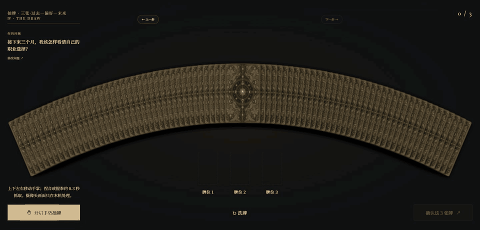
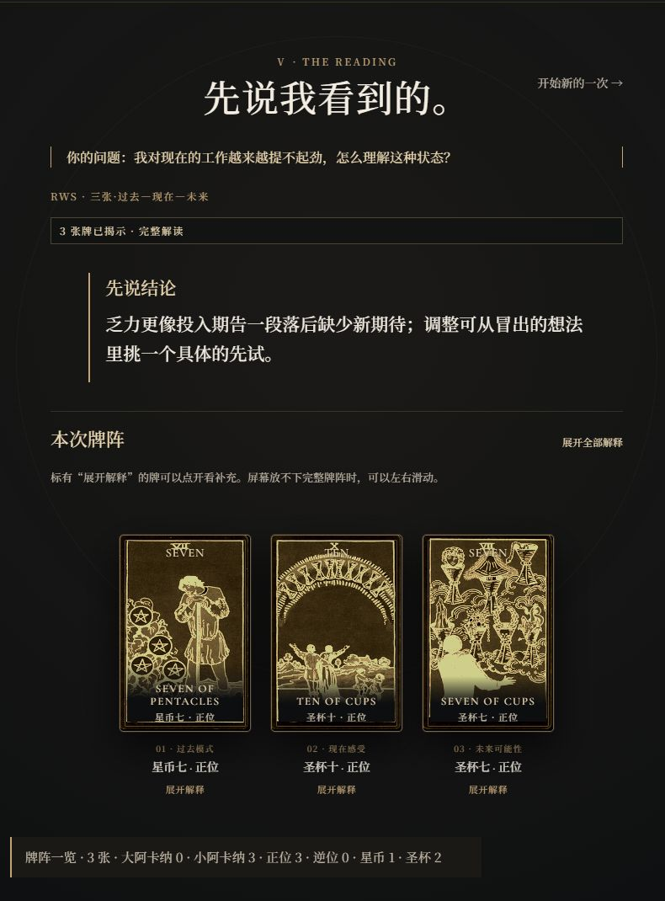

# ARCANA NOIR · 手势塔罗工坊

**把问题放上桌面，亲手抽出属于这一次的牌。**

[开始体验 →](https://taluo.space/)

## 第一幕 · 亲手抽牌

牌在桌面铺开，你可以打开摄像头用手势选择；也可以直接点击、触屏或使用键盘。从完整的 **78 张 Rider–Waite–Smith 塔罗牌**中抽出自己的牌，让它们依次落到牌位上。

## 第二幕 · 看见牌如何回应问题

下面是一次站内测试的结果。提问是：**“我对现在的工作越来越提不起劲，怎么理解这种状态？”** 已知背景是：在同一个岗位做了三年，工作稳定，最近几个月却缺少动力。

抽出的三张牌是 **星币七、圣杯十、圣杯七**，分别落在过去模式、现在感受和未来可能性。解读把它们连成一条线：三年的投入并没有白费，眼前的安稳和“没劲”也可以同时存在；接下来可能冒出不少新方向，先挑一个具体想法试一试，比急着给自己下结论更有帮助。

一次体验沿着 **提问 → 定位 → 牌阵 → 抽牌 → 解读** 展开。AI 会结合你提供的背景与抽到的牌，写出围绕这次问题的完整解读；完成后可以查看、打印或下载报告。塔罗用于整理视角与可能性，不替你作决定。

## 现在就试试

[进入 ARCANA NOIR](https://taluo.space/) · [隐私说明](https://taluo.space/privacy.html) · [使用条款](https://taluo.space/terms.html)

完整解读目前为 **¥9.9 / 次**，通过爱发电购买一次性兑换码解锁。

---

这个公开仓库用于展示项目。网站源码和服务器配置保留在私有仓库。
