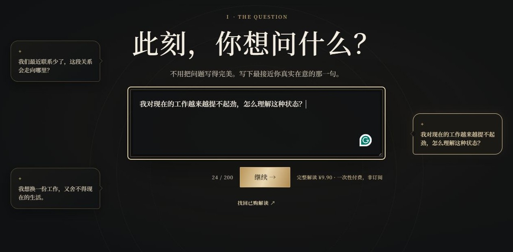
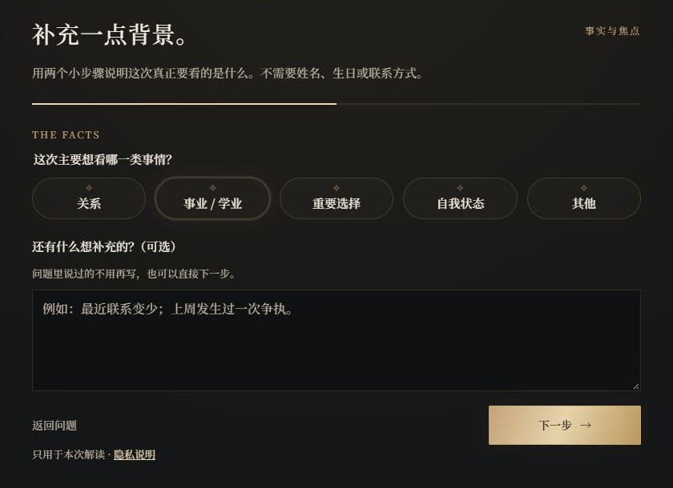
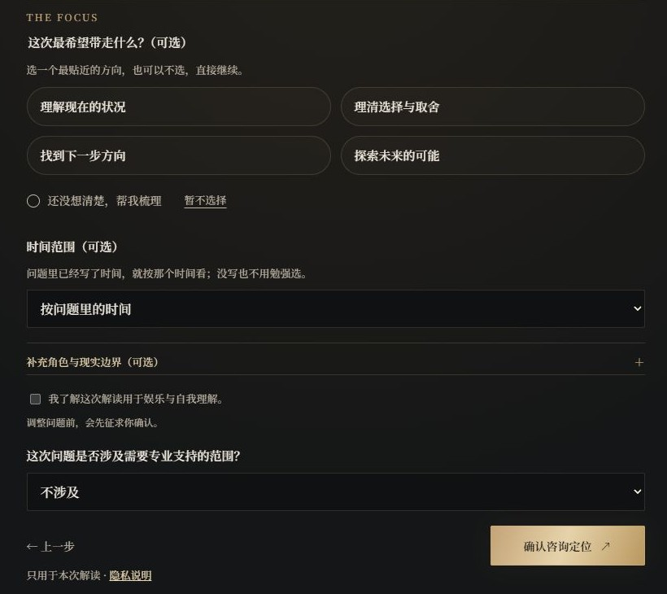
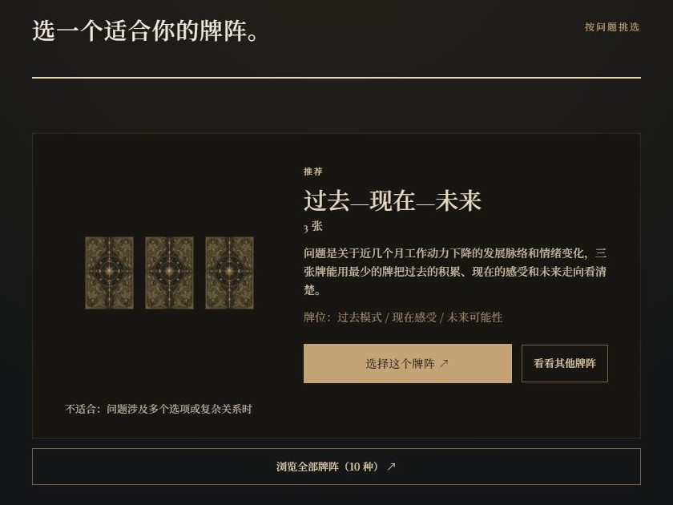
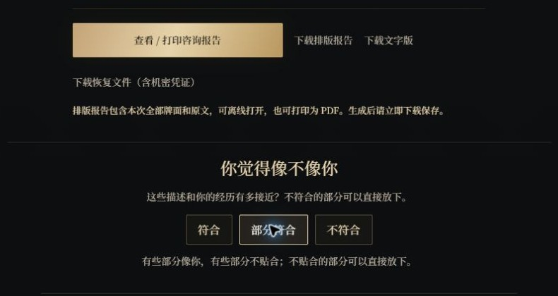

# ARCANA NOIR · 手势塔罗工坊

**把问题放上桌面，亲手抽出属于这一次的牌。**

一张黑金牌桌，一件你真正想弄明白的事。从写下问题，到亲手抽牌，再到读完一份围绕你处境展开的解读。

[开始体验 →](https://taluo.space/)

[提问](#第一幕--写下此刻的问题) → [定位](#第二幕--让问题有自己的背景) → [牌阵](#第三幕--选一个适合问题的牌阵) → [抽牌](#第四幕--亲手抽出这一次的牌) → [解读](#第五幕--看见牌如何回应问题)

## 第一幕 · 写下此刻的问题

不用先学会怎样提问。写下最接近真实感受的那一句，就可以开始。

下面用一次站内测试串起这段体验：**“我对现在的工作越来越提不起劲，怎么理解这种状态？”**

## 第二幕 · 让问题有自己的背景

选择这次关注的主题，再补充你愿意说的背景与期待。已经在问题里写过的内容不用重复；背景、焦点和时间范围都可以按需要补充。

这个案例补充的是：**在同一个岗位做了三年，工作稳定，最近几个月却缺少动力。** 这次希望先理解自己的状态。

看看如何选择这次解读的焦点

可以选择理解现状、理清取舍、寻找下一步，或探索未来的可能；还没想清楚，也可以继续。

## 第三幕 · 选一个适合问题的牌阵

AI 会根据问题推荐牌阵，并说明推荐理由。你也可以浏览其他选择，从 **3、4、5、7、10 张**牌阵中挑选适合自己的展开方式。

这次推荐的是三张牌的 **过去—现在—未来**：把长期积累、当下感受与接下来的可能性放到一起看。

## 第四幕 · 亲手抽出这一次的牌

完整的 **78 张 Rider–Waite–Smith 塔罗牌**在桌面铺开。打开摄像头，用手势选中一张牌，看它从牌扇中升起、落入牌位；也可以直接点击、触屏或使用键盘。

下面的动图展示站内抽牌操作。选满后确认牌面，进入解读。

## 第五幕 · 看见牌如何回应问题

确认牌面后，使用爱发电购买的一次性兑换码解锁完整解读。

回到“工作越来越提不起劲”的案例，抽出的三张牌是 **星币七、圣杯十、圣杯七**，分别落在过去模式、现在感受和未来可能性。

解读把三张牌连成一条线：三年的投入并没有白费，眼前的安稳和“没劲”也可以同时存在；接下来可能冒出不少新方向，先挑一个具体想法试一试，比急着给自己下结论更有帮助。

完整报告会展开这个判断，解释每张牌在对应位置上的含义，以及牌与牌之间怎样联系。你可以回看前面的步骤，也可以展开单牌补充，慢慢读。

## 尾声 · 把这次解读带走

读完之后，可以查看、打印或下载排版报告，也可以保存文字版。把当下的问题和这次抽到的牌留下，过一段时间再回来看。

这里的案例用于展示产品体验。AI 辅助解读提供整理视角与可能性的线索，选择仍由你自己作出。

## 现在就试试

[进入 ARCANA NOIR](https://taluo.space/) · [隐私说明](https://taluo.space/privacy.html) · [使用条款](https://taluo.space/terms.html)

完整解读目前为 **¥9.9 / 次**，通过爱发电购买一次性兑换码解锁。

---

这个公开仓库用于展示项目。网站源码和服务器配置保留在私有仓库。
