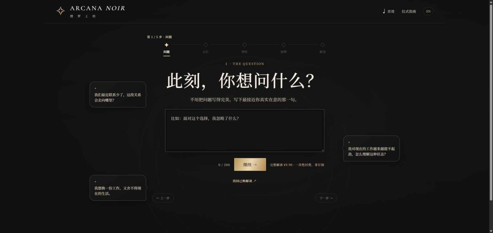
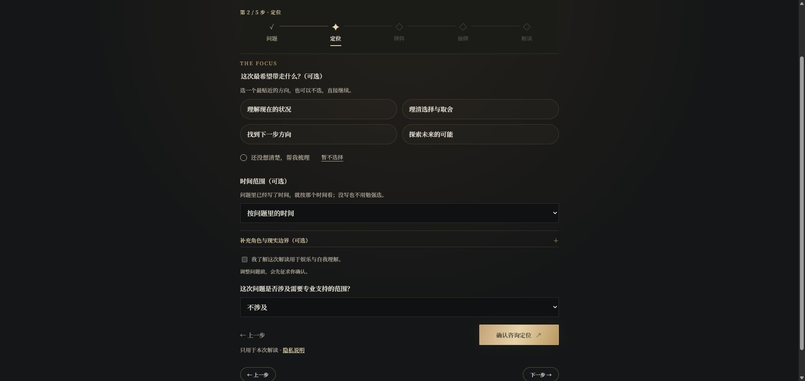

# ARCANA NOIR · 手势塔罗工坊

**给一个具体的问题，留一段认真看牌的时间。**

[进入网站](https://taluo.space/)

ARCANA NOIR 是一个黑金风格的在线塔罗体验。从提出问题到读完牌面，整个过程分为 **问题、定位、牌阵、抽牌、解读** 五章。它帮助你整理眼前的处境与可能的方向，而不是替你预言或作决定。

## 一次解读如何展开

先说出你想问的事，再补充与问题有关的背景。Claude Haiku 5.5 根据这些信息推荐牌阵；你可以在 **3、4、5、7、10 张牌阵**中选择，用手势或点击，从完整的 **78 张 Rider–Waite–Smith 塔罗牌**里亲自抽牌。之后由 Claude Opus 5.5 分析牌面，生成完整解读。

读完后可以下载报告留存。完整解读目前为 **¥9.9 / 次**，通过爱发电购买一次性兑换码解锁。

## 关于这个仓库

这里仅展示项目介绍和界面截图。网站源码与服务器配置保留在私有仓库，不在此公开。

[隐私说明](https://taluo.space/privacy.html) · [使用条款](https://taluo.space/terms.html)
