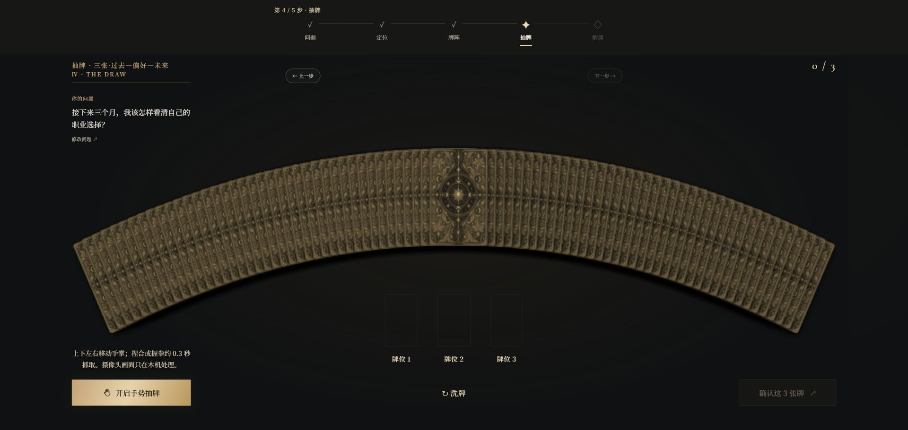

# ARCANA NOIR · 手势塔罗工坊

**把问题放上桌面，亲手抽出属于这一次的牌。**

[开始体验 →](https://taluo.space/)

## 抽牌，是体验的中心

牌在桌面铺开，你可以打开摄像头用手势选择；也可以直接点击、触屏或使用键盘。从完整的 **78 张 Rider–Waite–Smith 塔罗牌**中抽出自己的牌，让它们依次落到牌位上。

## 从你的问题出发

一次解读沿着 **提问 → 定位 → 牌阵 → 抽牌 → 解读** 展开。先说出想弄明白的事，补充必要的背景，再从 **3、4、5、7、10 张**牌阵中选择。AI 会结合你提供的信息与抽到的牌，给出围绕这次问题的解读；你也可以把报告下载留存。

这里展示的提问是虚构示例。塔罗用于整理视角与可能性，不代替你作决定。

## 现在就试试

[进入 ARCANA NOIR](https://taluo.space/) · [隐私说明](https://taluo.space/privacy.html) · [使用条款](https://taluo.space/terms.html)

完整解读目前为 **¥9.9 / 次**，通过爱发电购买一次性兑换码解锁。

---

这个公开仓库用于展示项目。网站源码和服务器配置保留在私有仓库。
